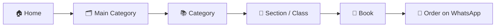

<div align="center">

# 📚 Raees Doultana Book House

**A full-stack wholesale bookseller website with a dynamic admin panel and WhatsApp ordering.**


[🌐 Live Website](https://raeesdoultanabookhouse.com) · [✨ Features](#-features) · [🚀 Quick Start](#-quick-start) · [🔐 Admin Panel](#-admin-panel) · [🔎 SEO](#-seo--google-indexing)

</div>

---

## 📖 Table of Contents

- [✨ Features](#-features)
- [🧭 How Content Is Organised](#-how-content-is-organised)
- [🛠️ Tech Stack](#️-tech-stack)
- [🚀 Quick Start](#-quick-start)
- [🔐 Admin Panel](#-admin-panel)
- [💬 WhatsApp Ordering](#-whatsapp-ordering)
- [🔎 SEO & Google Indexing](#-seo--google-indexing)
- [📁 Project Structure](#-project-structure)
- [⬆️ Upgrading an Existing Site](#️-upgrading-an-existing-site)
- [🌍 Using It on Your Own Domain](#-using-it-on-your-own-domain)
- [🗺️ Roadmap](#️-roadmap)

---

## ✨ Features

### 🛍️ For customers

| | Feature | Details |
|---|---|---|
| 🏠 | **Animated homepage** | Hero with a 3D bookshelf animation, scrolling publisher marquee, reviews and gallery |
| 🧭 | **Mega-menu navigation** | Hover (or tap on mobile) to open Main Category → Category → Section |
| 🔍 | **Smart search** | Case-insensitive, partial-match book search with a cascading category picker |
| 📚 | **Featured shelves** | One container per Main Category, horizontal-scroll rows per Category, class tags and arrow buttons |
| 📖 | **Book detail pages** | Every book has its own page with price, rating and an order button |
| ⭐ | **Rating overlay** | Hover a cover to see its stars and an **Order Now** button |
| 💬 | **WhatsApp ordering** | One tap opens a chat with the book, publisher, category and section pre-filled |
| 📱 | **Fully responsive** | Built without a CSS framework, tuned for phones, tablets and desktops |
| 🎞️ | **Motion with care** | 3D tilt cards, scroll reveals, and reduced-motion / touch fallbacks |

### 🧑‍💼 For the admin

| | Feature | Details |
|---|---|---|
| 🗂️ | **Unlimited hierarchy** | Add as many categories, sections and books as needed |
| 🖼️ | **Image uploads** | Cover images for main categories, categories and books |
| 🔎 | **Searchable dropdowns** | Type to find a category or section instead of scrolling a long list |
| ⚡ | **Live table filters** | Instant search on the Sections and Books lists to edit or delete quickly |
| ⭐ | **Ratings & specials** | Set a 1–5 star rating and mark books as *Wholesale Special* |
| ⚙️ | **Site settings** | Logo, WhatsApp numbers, phone, email, addresses and the marquee list |

---

## 🧭 How Content Is Organised



```
Main Category   Publisher / Countries / School
 └── Category   e.g. Oxford, Punjab Textbook Board
      └── Section   e.g. Class 9, Class 10, Nursery
           └── Book   cover photo + price + rating + WhatsApp button
```

> 💡 **Tip:** Sections are ordered by their *Display Order* number. Give Class 9 and Class 10 the lowest numbers (0, 1) so they always appear first.

---

## 🛠️ Tech Stack

| Layer | Technology |
|---|---|
| 🖥️ Frontend | HTML5, CSS3 (custom, no framework), vanilla JavaScript |
| ⚙️ Backend | PHP 8+ with PDO prepared statements |
| 🗄️ Database | MySQL / MariaDB |
| 🔤 Fonts | Playfair Display and Inter (Google Fonts) |

---

## 🚀 Quick Start

### 1️⃣ Requirements

- PHP 8.0 or newer
- MySQL or MariaDB
- Any web host, or XAMPP / WAMP / Laragon for local development

### 2️⃣ Get the code

```bash
git clone https://github.com/YOUR_USERNAME/Raees-book-house.git
cd Raees-book-house
```

### 3️⃣ Create the database

1. Open phpMyAdmin and create an empty database.
2. Select it and **Import** `database.sql`.

> 🏷️ **Shared hosting:** many hosts add a prefix to database and user names (for example `u123456_mydb`). Always use the **full prefixed name** in the config below.

### 4️⃣ Connect the site to the database

```bash
cp config/db.example.php config/db.php
```

Edit `config/db.php`:

```php
define('DB_HOST', 'localhost');
define('DB_NAME', 'your_database_name');
define('DB_USER', 'your_database_user');
define('DB_PASS', 'your_database_password');
```

> 🔒 `config/db.php` is listed in `.gitignore`, so your credentials are never pushed to GitHub.

### 5️⃣ Allow image uploads (Linux / shared hosting)

```bash
chmod -R 755 uploads/
```

### 6️⃣ Open the site

```
http://localhost/Raees-book-house/index.php
```

---

## 🔐 Admin Panel

Open `/admin/login.php`.

### Create your first admin account

Generate a password hash:

```bash
php -r "echo password_hash('YourStrongPassword', PASSWORD_DEFAULT), PHP_EOL;"
```

Then run this in phpMyAdmin's SQL tab, pasting your hash:

```sql
INSERT INTO admins (username, password) VALUES ('admin', 'PASTE_HASH_HERE');
```

> ⚠️ Use a strong, unique password. There is no change-password screen yet, so to change it later, update the `admins` table with a new hash.

### What you can manage

| Menu | What it does |
|---|---|
| 📊 **Dashboard** | Overview of your catalogue |
| 🏛️ **Main Categories** | The top-level types (Publisher, Countries, School) with their images |
| 🗂️ **Categories** | Add categories inside a Main Category |
| 📁 **Sections / Parts** | Add sections (classes) inside a category |
| 📖 **Books** | Upload covers, set price, rating and *Wholesale Special* |
| ⚙️ **Site Settings** | Logo, contact details, WhatsApp numbers, marquee list |

---

## 💬 WhatsApp Ordering

Every **Order on WhatsApp** button opens a chat with the primary WhatsApp number from **Site Settings**. The message is pre-filled with the book title, publisher, category and section, so the customer only needs to tap *Send*.

---

## 🔎 SEO & Google Indexing

The site is built to be found on Google:

- 🗺️ **`sitemap.php`** lists every main category, category, section and book automatically
- 🤖 **`robots.txt`** allows crawling and blocks `/admin/` and `/uploads/`
- 🔗 **Canonical URLs** on every page
- 🏪 **BookStore structured data** (JSON-LD) with contact details and categories
- 🛒 **Product structured data** on each book page (name, image, price, publisher)
- 📣 **Open Graph tags**, so shared links show the book image and title on WhatsApp and Facebook
- 📝 **Per-page titles and descriptions** for books, sections and main categories

**After going live:**

1. Add your site to [Google Search Console](https://search.google.com/search-console) (the **URL prefix** option works with the HTML tag method).
2. Open **Sitemaps** and submit `sitemap.php`.
3. Use **URL Inspection → Request Indexing** on your homepage and a few key pages.
4. Be patient. Google usually takes days to weeks to crawl a new site.

---

## 📁 Project Structure

```
.
├── index.php               🏠 Homepage
├── main-category.php       🗂️ Categories inside a Main Category
├── category.php            📚 Sections inside a Category
├── part.php                📁 Books inside a Section
├── book.php                📖 Single book page
├── search.php              🔍 Search results
├── sitemap.php             🗺️ Auto-generated XML sitemap
├── robots.txt              🤖 Crawler rules
├── database.sql            🗄️ Database schema
├── config/
│   ├── db.php              🔒 Your credentials (git-ignored)
│   └── db.example.php      📄 Template to copy
├── includes/               🧩 Shared header, footer and pickers
├── assets/
│   ├── css/style.css       🎨 All styling
│   ├── js/                 ⚡ Menus, animations, search widgets
│   └── images/             🖼️ Logo and gallery photos
├── admin/                  🔐 Admin panel (login required)
└── uploads/                📤 Uploaded images (git-ignored)
```

---

## ⬆️ Upgrading an Existing Site

If you already have a live site with data, **do not re-import `database.sql`**, because it would overwrite your data. Run only what you need.

<details>
<summary><b>🆕 Adding the Main Categories level</b> (older sites with a single Categories level)</summary>

```sql
CREATE TABLE IF NOT EXISTS main_categories (
    id INT AUTO_INCREMENT PRIMARY KEY,
    name VARCHAR(150) NOT NULL,
    slug VARCHAR(160) NOT NULL UNIQUE,
    description VARCHAR(500) DEFAULT NULL,
    image VARCHAR(255) DEFAULT NULL,
    sort_order INT DEFAULT 0,
    status ENUM('active','hidden') DEFAULT 'active',
    created_at TIMESTAMP DEFAULT CURRENT_TIMESTAMP
);

INSERT INTO main_categories (id, name, slug, description, sort_order) VALUES
(1, 'Publisher', 'publisher', 'Browse books by publisher.', 1),
(2, 'Countries', 'countries', 'Browse books by country / curriculum origin.', 2),
(3, 'School', 'school', 'Browse books by school / board.', 3);

ALTER TABLE categories ADD COLUMN main_category_id INT NOT NULL DEFAULT 1 AFTER id;
ALTER TABLE categories ADD CONSTRAINT fk_cat_main
  FOREIGN KEY (main_category_id) REFERENCES main_categories(id) ON DELETE CASCADE;
```

Then, in **Admin → Categories**, open each existing category once and pick its correct Main Category.

</details>

<details>
<summary><b>⭐ Adding book ratings</b> (older sites without the rating column)</summary>

```sql
ALTER TABLE books ADD COLUMN rating TINYINT NOT NULL DEFAULT 5 AFTER image;
```

</details>

---

## 🌍 Using It on Your Own Domain

The live domain appears in a few places. Replace `raeesdoultanabookhouse.com` with yours in:

- `sitemap.php`
- `robots.txt`
- `book.php`
- `includes/header.php` (canonical URL and structured data)

Also remove or replace the `google-site-verification` meta tag in `includes/header.php` with your own.

---

## 🗺️ Roadmap

- [ ] 🔑 Change-password screen in the admin panel
- [ ] 💬 Manage customer reviews from the admin panel (currently written in `index.php`)
- [ ] 🖼️ Upload gallery photos from the admin panel (currently loaded from `assets/images/gallery/`)
- [ ] 📄 Pagination for very large book lists

---

<div align="center">

Built with ❤️ for **Raees Doultana Book House**, Urdu Bazar, Lahore.

</div>
